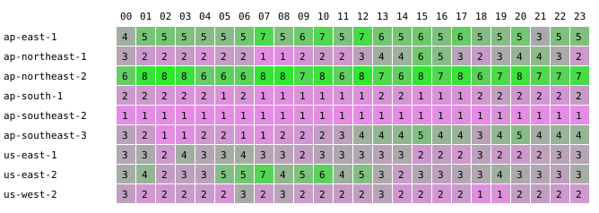

# Spot placement score log

Generated 2026-11-15 16:59 UTC. Scores are 1–10; a region counts as available at ≥ 5. The single-type set is scored low by design (EC2 wants three or more instance types); read it relative to itself over time and use the trio set as the calibrated reference.

## g5.xlarge (g5.xlarge)

| region | samples | hours ≥ 5 | mean score | latest |
|---|---|---|---|---|
| ap-east-1 | 539 | 49% | 5.2 | 6 (11-15 16:59Z) |
| ap-northeast-1 | 539 | 17% | 2.8 | 9 (11-15 16:59Z) |
| ap-northeast-2 | 539 | 68% | 7.0 | 9 (11-15 16:59Z) |
| ap-south-1 | 539 | 3% | 1.7 | 1 (11-15 16:59Z) |
| ap-southeast-2 | 539 | 1% | 1.0 | 1 (11-15 16:59Z) |
| ap-southeast-3 | 539 | 24% | 3.1 | 3 (11-15 16:59Z) |
| us-east-1 | 539 | 10% | 2.7 | 7 (11-15 16:59Z) |
| us-east-2 | 539 | 30% | 3.6 | 9 (11-15 16:59Z) |
| us-west-2 | 539 | 9% | 2.1 | 1 (11-15 16:59Z) |

### Last 48 samples

```
region           oldest → newest (48 h, one char per sample)
ap-east-1        919111129911191999919998199191219111111111991996
ap-northeast-1   911911122112111191999199112111115111211299959999
ap-northeast-2   999929999999999999999999999999919111111111999999
ap-south-1       111112111222221222113119111122111111111111111911
ap-southeast-2   111111171111111111111111111111111111111111111111
ap-southeast-3   811111111113111111111131111111113111111111112113
us-east-1        121123333322322132222223292933224232333442233237
us-east-2        911912111911111119999199991111111111111111199199
us-west-2        211222111911111229221112111112122211121221112191
```

### Mean score by UTC hour

| region | 00 | 01 | 02 | 03 | 04 | 05 | 06 | 07 | 08 | 09 | 10 | 11 | 12 | 13 | 14 | 15 | 16 | 17 | 18 | 19 | 20 | 21 | 22 | 23 |
|---|---|---|---|---|---|---|---|---|---|---|---|---|---|---|---|---|---|---|---|---|---|---|---|---|
| ap-east-1 | 4 | 5 | 5 | 5 | 5 | 5 | 5 | 7 | 5 | 6 | 7 | 5 | 7 | 6 | 5 | 6 | 5 | 6 | 5 | 5 | 5 | 3 | 5 | 5 |
| ap-northeast-1 | 3 | 2 | 2 | 2 | 2 | 2 | 2 | 1 | 1 | 2 | 2 | 2 | 3 | 4 | 4 | 6 | 5 | 3 | 2 | 3 | 4 | 4 | 3 | 2 |
| ap-northeast-2 | 6 | 8 | 8 | 7 | 6 | 6 | 6 | 8 | 8 | 7 | 8 | 6 | 8 | 7 | 6 | 8 | 7 | 8 | 6 | 7 | 8 | 7 | 7 | 7 |
| ap-south-1 | 2 | 2 | 2 | 2 | 2 | 1 | 2 | 1 | 1 | 1 | 1 | 1 | 1 | 2 | 2 | 1 | 1 | 1 | 2 | 2 | 2 | 2 | 2 | 2 |
| ap-southeast-2 | 1 | 1 | 1 | 1 | 1 | 1 | 1 | 1 | 1 | 1 | 1 | 1 | 1 | 1 | 1 | 1 | 1 | 1 | 1 | 1 | 1 | 1 | 1 | 1 |
| ap-southeast-3 | 3 | 2 | 1 | 1 | 2 | 2 | 1 | 1 | 2 | 2 | 2 | 3 | 4 | 5 | 4 | 5 | 4 | 4 | 3 | 4 | 5 | 4 | 4 | 4 |
| us-east-1 | 3 | 3 | 2 | 4 | 3 | 3 | 4 | 3 | 3 | 2 | 3 | 3 | 3 | 2 | 3 | 2 | 2 | 2 | 3 | 2 | 2 | 2 | 3 | 3 |
| us-east-2 | 3 | 4 | 2 | 3 | 2 | 5 | 5 | 7 | 4 | 5 | 6 | 4 | 5 | 3 | 2 | 3 | 3 | 3 | 3 | 4 | 3 | 3 | 3 | 3 |
| us-west-2 | 3 | 2 | 2 | 2 | 2 | 2 | 3 | 2 | 3 | 2 | 2 | 2 | 2 | 3 | 2 | 2 | 2 | 2 | 1 | 1 | 2 | 2 | 2 | 2 |



### Best single AZ per sample

| region | samples | hours ≥ 5 | mean score | latest |
|---|---|---|---|---|
| ap-east-1 ape1-az1 | 168 | 5% | 1.5 | 1 (11-13 07:49Z) |
| ap-east-1 ape1-az2 | 395 | 66% | 6.6 | 6 (11-15 16:59Z) |
| ap-northeast-1 apne1-az1 | 129 | 11% | 2.0 | 2 (11-15 16:59Z) |
| ap-northeast-1 apne1-az4 | 250 | 28% | 3.6 | 6 (11-15 16:59Z) |
| ap-northeast-2 apne2-az1 | 459 | 63% | 6.6 | 9 (11-15 16:59Z) |
| ap-northeast-2 apne2-az3 | 498 | 69% | 7.0 | 9 (11-15 16:59Z) |
| ap-northeast-2 apne2-az4 | 526 | 70% | 7.2 | 9 (11-15 16:59Z) |
| ap-south-1 aps1-az1 | 157 | 1% | 1.4 | 3 (11-15 01:47Z) |
| ap-south-1 aps1-az3 | 155 | 7% | 2.3 | 7 (11-15 01:47Z) |
| ap-southeast-2 apse2-az1 | 110 | 3% | 1.2 | 1 (11-14 03:05Z) |
| ap-southeast-2 apse2-az2 | 79 | 0% | 1.0 | 1 (11-15 01:47Z) |
| ap-southeast-3 apse3-az1 | 93 | 0% | 1.0 | 1 (11-13 00:11Z) |
| ap-southeast-3 apse3-az3 | 328 | 37% | 4.3 | 3 (11-15 16:59Z) |
| us-east-1 use1-az1 | 114 | 0% | 1.1 | 1 (11-15 01:47Z) |
| us-east-1 use1-az2 | 140 | 3% | 1.4 | 1 (11-13 07:49Z) |
| us-east-1 use1-az4 | 171 | 22% | 2.9 | 1 (11-15 09:13Z) |
| us-east-1 use1-az5 | 172 | 24% | 3.1 | 1 (11-13 07:49Z) |
| us-east-1 use1-az6 | 132 | 23% | 3.0 | 1 (11-14 16:59Z) |
| us-east-2 use2-az1 | 236 | 42% | 4.6 | 9 (11-15 09:13Z) |
| us-east-2 use2-az2 | 274 | 51% | 5.3 | 9 (11-15 16:59Z) |
| us-east-2 use2-az3 | 304 | 47% | 5.1 | 9 (11-15 16:59Z) |
| us-west-2 usw2-az1 | 170 | 22% | 3.0 | 1 (11-15 16:59Z) |
| us-west-2 usw2-az2 | 125 | 17% | 2.5 | 1 (11-13 16:10Z) |
| us-west-2 usw2-az3 | 205 | 17% | 2.7 | 1 (11-15 09:13Z) |

## g-xlarge-trio (g5.xlarge, g4dn.xlarge, g6.xlarge)

| region | samples | hours ≥ 5 | mean score | latest |
|---|---|---|---|---|
| ap-east-1 | 539 | 72% | 7.3 | 9 (11-15 16:59Z) |
| ap-northeast-1 | 539 | 73% | 7.0 | 9 (11-15 16:59Z) |
| ap-northeast-2 | 539 | 100% | 9.0 | 9 (11-15 16:59Z) |
| ap-south-1 | 539 | 60% | 6.1 | 1 (11-15 16:59Z) |
| ap-southeast-2 | 539 | 27% | 3.6 | 9 (11-15 16:59Z) |
| ap-southeast-3 | 539 | 24% | 3.1 | 3 (11-15 16:59Z) |
| us-east-1 | 539 | 72% | 6.5 | 9 (11-15 16:59Z) |
| us-east-2 | 539 | 68% | 6.7 | 9 (11-15 16:59Z) |
| us-west-2 | 539 | 51% | 5.6 | 9 (11-15 16:59Z) |

### Last 48 samples

```
region           oldest → newest (48 h, one char per sample)
ap-east-1        999999999999999999999999999999999999999999999999
ap-northeast-1   999992199199229999999999939229929928942999999999
ap-northeast-2   999999999999999999999999999999999999999999999999
ap-south-1       191129119229921992179119913922911111191111119911
ap-southeast-2   111911191991199999999199119119119919911913299999
ap-southeast-3   811111111113111111111131111111113111111111112113
us-east-1        452346976555795799999999995996699689669789999979
us-east-2        919919912911191199999999991199199199999999999999
us-west-2        924454342949441959559999994943349334341942399399
```

### Mean score by UTC hour

| region | 00 | 01 | 02 | 03 | 04 | 05 | 06 | 07 | 08 | 09 | 10 | 11 | 12 | 13 | 14 | 15 | 16 | 17 | 18 | 19 | 20 | 21 | 22 | 23 |
|---|---|---|---|---|---|---|---|---|---|---|---|---|---|---|---|---|---|---|---|---|---|---|---|---|
| ap-east-1 | 6 | 8 | 9 | 8 | 6 | 7 | 7 | 8 | 8 | 7 | 8 | 6 | 8 | 7 | 6 | 8 | 7 | 8 | 7 | 7 | 8 | 7 | 7 | 7 |
| ap-northeast-1 | 7 | 4 | 3 | 3 | 4 | 5 | 4 | 4 | 4 | 4 | 5 | 7 | 9 | 9 | 9 | 9 | 9 | 9 | 9 | 9 | 9 | 9 | 9 | 9 |
| ap-northeast-2 | 9 | 9 | 9 | 9 | 9 | 9 | 9 | 9 | 9 | 9 | 9 | 9 | 9 | 9 | 9 | 9 | 9 | 9 | 9 | 9 | 9 | 9 | 9 | 9 |
| ap-south-1 | 8 | 9 | 8 | 7 | 6 | 6 | 5 | 3 | 4 | 3 | 3 | 4 | 3 | 5 | 4 | 5 | 5 | 5 | 7 | 8 | 7 | 7 | 8 | 8 |
| ap-southeast-2 | 3 | 3 | 3 | 2 | 2 | 3 | 3 | 2 | 2 | 3 | 3 | 4 | 4 | 6 | 5 | 6 | 5 | 5 | 6 | 5 | 3 | 3 | 3 | 2 |
| ap-southeast-3 | 3 | 2 | 1 | 1 | 2 | 2 | 1 | 1 | 2 | 2 | 2 | 3 | 4 | 5 | 4 | 5 | 4 | 4 | 3 | 4 | 5 | 4 | 4 | 4 |
| us-east-1 | 7 | 7 | 6 | 7 | 7 | 8 | 8 | 7 | 7 | 8 | 8 | 8 | 6 | 6 | 6 | 5 | 5 | 5 | 5 | 6 | 6 | 6 | 6 | 6 |
| us-east-2 | 7 | 6 | 6 | 8 | 8 | 9 | 9 | 9 | 7 | 9 | 9 | 9 | 8 | 7 | 6 | 5 | 6 | 5 | 6 | 7 | 5 | 5 | 5 | 6 |
| us-west-2 | 5 | 5 | 4 | 4 | 5 | 6 | 8 | 6 | 6 | 5 | 6 | 7 | 8 | 7 | 7 | 7 | 5 | 5 | 5 | 5 | 6 | 5 | 5 | 5 |


### Best single AZ per sample

| region | samples | hours ≥ 5 | mean score | latest |
|---|---|---|---|---|
| ap-east-1 ape1-az1 | 344 | 84% | 8.1 | 9 (11-14 03:05Z) |
| ap-east-1 ape1-az2 | 313 | 87% | 8.2 | 9 (11-15 16:59Z) |
| ap-east-1 ape1-az3 | 345 | 87% | 8.2 | 9 (11-15 16:59Z) |
| ap-northeast-1 apne1-az1 | 216 | 95% | 8.7 | 9 (11-14 16:59Z) |
| ap-northeast-1 apne1-az2 | 201 | 87% | 8.2 | 9 (11-15 16:59Z) |
| ap-northeast-1 apne1-az4 | 278 | 99% | 8.9 | 9 (11-15 09:13Z) |
| ap-northeast-2 apne2-az1 | 437 | 100% | 9.0 | 9 (11-15 16:59Z) |
| ap-northeast-2 apne2-az2 | 118 | 86% | 8.1 | 9 (11-14 16:59Z) |
| ap-northeast-2 apne2-az3 | 452 | 100% | 9.0 | 9 (11-15 09:13Z) |
| ap-northeast-2 apne2-az4 | 353 | 87% | 8.2 | 9 (11-15 01:47Z) |
| ap-south-1 aps1-az1 | 179 | 88% | 8.3 | 9 (11-13 00:11Z) |
| ap-south-1 aps1-az2 | 187 | 80% | 7.8 | 9 (11-10 23:11Z) |
| ap-south-1 aps1-az3 | 201 | 90% | 8.4 | 9 (11-14 21:23Z) |
| ap-southeast-2 apse2-az1 | 72 | 86% | 8.1 | 9 (11-13 16:10Z) |
| ap-southeast-2 apse2-az2 | 3 | 67% | 7.0 | 9 (10-31 19:10Z) |
| ap-southeast-2 apse2-az3 | 87 | 84% | 8.0 | 9 (11-15 16:59Z) |
| ap-southeast-3 apse3-az3 | 74 | 39% | 5.2 | 9 (10-31 22:12Z) |
| us-east-1 use1-az1 | 30 | 53% | 5.6 | 9 (11-14 16:59Z) |
| us-east-1 use1-az2 | 116 | 99% | 8.9 | 9 (11-15 01:47Z) |
| us-east-1 use1-az4 | 155 | 92% | 8.4 | 9 (11-15 01:47Z) |
| us-east-1 use1-az5 | 112 | 98% | 8.9 | 9 (11-15 16:59Z) |
| us-east-1 use1-az6 | 137 | 93% | 8.5 | 9 (11-15 16:59Z) |
| us-east-2 use2-az1 | 192 | 99% | 8.9 | 9 (11-15 16:59Z) |
| us-east-2 use2-az2 | 210 | 99% | 8.9 | 9 (11-14 10:14Z) |
| us-east-2 use2-az3 | 238 | 97% | 8.8 | 9 (11-15 09:13Z) |
| us-west-2 usw2-az1 | 102 | 98% | 8.9 | 9 (11-15 16:59Z) |
| us-west-2 usw2-az2 | 97 | 91% | 8.3 | 9 (11-11 14:05Z) |
| us-west-2 usw2-az3 | 141 | 88% | 8.2 | 9 (11-15 16:59Z) |

## Latest spot prices

| region | az | product | $/h | sampled |
|---|---|---|---|---|
| ap-northeast-1 | ap-northeast-1a | Linux/UNIX | 0.704300 | 2026-11-15T16:59:34Z |
| ap-northeast-1 | ap-northeast-1a | Windows | 0.840600 | 2026-11-15T16:59:34Z |
| ap-northeast-1 | ap-northeast-1c | Linux/UNIX | 0.716400 | 2026-11-15T16:59:34Z |
| ap-northeast-1 | ap-northeast-1c | Windows | 0.840600 | 2026-11-15T16:59:34Z |
| ap-northeast-2 | ap-northeast-2a | Linux/UNIX | 0.604100 | 2026-11-15T16:59:34Z |
| ap-northeast-2 | ap-northeast-2a | Windows | 0.740700 | 2026-11-15T16:59:34Z |
| ap-northeast-2 | ap-northeast-2c | Linux/UNIX | 0.617700 | 2026-11-15T16:59:34Z |
| ap-northeast-2 | ap-northeast-2c | Windows | 0.740700 | 2026-11-15T16:59:34Z |
| ap-northeast-2 | ap-northeast-2d | Linux/UNIX | 0.605600 | 2026-11-15T16:59:34Z |
| ap-northeast-2 | ap-northeast-2d | Windows | 0.740700 | 2026-11-15T16:59:34Z |
| ap-south-1 | ap-south-1a | Linux/UNIX | 0.680900 | 2026-11-15T16:59:34Z |
| ap-south-1 | ap-south-1a | Windows | 0.403100 | 2026-11-15T16:59:34Z |
| ap-south-1 | ap-south-1b | Linux/UNIX | 0.633000 | 2026-11-15T16:59:34Z |
| ap-south-1 | ap-south-1b | Windows | 0.401900 | 2026-11-15T16:59:34Z |
| ap-southeast-2 | ap-southeast-2a | Linux/UNIX | 0.635800 | 2026-11-15T16:59:34Z |
| ap-southeast-2 | ap-southeast-2a | Windows | 0.508100 | 2026-11-15T16:59:34Z |
| ap-southeast-2 | ap-southeast-2c | Linux/UNIX | 0.527200 | 2026-11-15T16:59:34Z |
| ap-southeast-2 | ap-southeast-2c | Windows | 0.542300 | 2026-11-15T16:59:34Z |
| us-east-1 | us-east-1a | Linux/UNIX | 0.866600 | 2026-11-15T16:59:34Z |
| us-east-1 | us-east-1a | Windows | 0.284600 | 2026-11-15T16:59:34Z |
| us-east-1 | us-east-1b | Linux/UNIX | 0.810700 | 2026-11-15T16:59:34Z |
| us-east-1 | us-east-1b | Windows | 0.284600 | 2026-11-15T16:59:34Z |
| us-east-1 | us-east-1c | Linux/UNIX | 0.576000 | 2026-11-15T16:59:34Z |
| us-east-1 | us-east-1c | Windows | 0.284600 | 2026-11-15T16:59:34Z |
| us-east-1 | us-east-1d | Linux/UNIX | 0.591300 | 2026-11-15T16:59:34Z |
| us-east-1 | us-east-1d | Windows | 0.284600 | 2026-11-15T16:59:34Z |
| us-east-1 | us-east-1f | Linux/UNIX | 0.513700 | 2026-11-15T16:59:34Z |
| us-east-1 | us-east-1f | Windows | 0.284600 | 2026-11-15T16:59:34Z |
| us-east-2 | us-east-2a | Linux/UNIX | 0.548200 | 2026-11-15T16:59:34Z |
| us-east-2 | us-east-2a | Windows | 0.636700 | 2026-11-15T16:59:34Z |
| us-east-2 | us-east-2b | Linux/UNIX | 0.585800 | 2026-11-15T16:59:34Z |
| us-east-2 | us-east-2b | Windows | 0.636700 | 2026-11-15T16:59:34Z |
| us-east-2 | us-east-2c | Linux/UNIX | 0.549900 | 2026-11-15T16:59:34Z |
| us-east-2 | us-east-2c | Windows | 0.636700 | 2026-11-15T16:59:34Z |
| us-west-2 | us-west-2a | Linux/UNIX | 0.665000 | 2026-11-15T16:59:34Z |
| us-west-2 | us-west-2a | Windows | 0.335800 | 2026-11-15T16:59:34Z |
| us-west-2 | us-west-2b | Linux/UNIX | 0.553900 | 2026-11-15T16:59:34Z |
| us-west-2 | us-west-2b | Windows | 0.285700 | 2026-11-15T16:59:34Z |
| us-west-2 | us-west-2c | Linux/UNIX | 0.606100 | 2026-11-15T16:59:34Z |
| us-west-2 | us-west-2c | Windows | 0.284600 | 2026-11-15T16:59:34Z |
