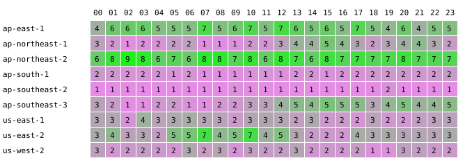
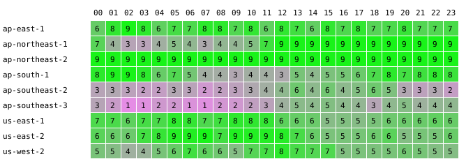

# Spot placement score log

Generated 2026-11-10 23:11 UTC. Scores are 1–10; a region counts as available at ≥ 5. The single-type set is scored low by design (EC2 wants three or more instance types); read it relative to itself over time and use the trio set as the calibrated reference.

## g5.xlarge (g5.xlarge)

| region | samples | hours ≥ 5 | mean score | latest |
|---|---|---|---|---|
| ap-east-1 | 522 | 49% | 5.2 | 2 (11-10 23:11Z) |
| ap-northeast-1 | 522 | 16% | 2.7 | 1 (11-10 23:11Z) |
| ap-northeast-2 | 522 | 69% | 7.1 | 9 (11-10 23:11Z) |
| ap-south-1 | 522 | 3% | 1.7 | 1 (11-10 23:11Z) |
| ap-southeast-2 | 522 | 1% | 1.0 | 1 (11-10 23:11Z) |
| ap-southeast-3 | 522 | 25% | 3.2 | 1 (11-10 23:11Z) |
| us-east-1 | 522 | 10% | 2.6 | 2 (11-10 23:11Z) |
| us-east-2 | 522 | 30% | 3.7 | 1 (11-10 23:11Z) |
| us-west-2 | 522 | 9% | 2.1 | 1 (11-10 23:11Z) |

### Last 48 samples

```
region           oldest → newest (48 h, one char per sample)
ap-east-1        999911199999999919191111299111919999199981991912
ap-northeast-1   187911147888195119119111221121111919991991121111
ap-northeast-2   999919999999999999999299999999999999999999999999
ap-south-1       111111111111169811111121112222212221131191111221
ap-southeast-2   111111111111111111111111711111111111111111111111
ap-southeast-3   125411183973138618111111111131111111111311111111
us-east-1        122111111111299991211233333223221322222232929332
us-east-2        121119991196999999119121119111111199991999911111
us-west-2        413111111111171112112221119111112292211121111121
```

### Mean score by UTC hour

| region | 00 | 01 | 02 | 03 | 04 | 05 | 06 | 07 | 08 | 09 | 10 | 11 | 12 | 13 | 14 | 15 | 16 | 17 | 18 | 19 | 20 | 21 | 22 | 23 |
|---|---|---|---|---|---|---|---|---|---|---|---|---|---|---|---|---|---|---|---|---|---|---|---|---|
| ap-east-1 | 4 | 5 | 6 | 6 | 5 | 5 | 5 | 7 | 5 | 6 | 7 | 5 | 7 | 6 | 5 | 6 | 5 | 6 | 5 | 5 | 5 | 4 | 5 | 5 |
| ap-northeast-1 | 3 | 2 | 2 | 2 | 2 | 2 | 2 | 1 | 1 | 1 | 2 | 2 | 3 | 4 | 4 | 6 | 5 | 3 | 2 | 3 | 4 | 4 | 3 | 2 |
| ap-northeast-2 | 6 | 8 | 9 | 8 | 6 | 7 | 6 | 8 | 8 | 7 | 8 | 6 | 8 | 7 | 6 | 8 | 7 | 8 | 7 | 7 | 8 | 7 | 7 | 7 |
| ap-south-1 | 2 | 2 | 2 | 2 | 2 | 1 | 2 | 1 | 1 | 1 | 1 | 1 | 1 | 2 | 2 | 1 | 1 | 1 | 2 | 2 | 2 | 2 | 2 | 2 |
| ap-southeast-2 | 1 | 1 | 1 | 1 | 1 | 1 | 1 | 1 | 1 | 1 | 1 | 1 | 1 | 1 | 1 | 1 | 1 | 1 | 1 | 1 | 1 | 1 | 1 | 1 |
| ap-southeast-3 | 3 | 2 | 1 | 1 | 2 | 2 | 1 | 1 | 2 | 2 | 2 | 3 | 4 | 5 | 4 | 5 | 4 | 4 | 3 | 4 | 5 | 4 | 4 | 4 |
| us-east-1 | 3 | 3 | 2 | 4 | 3 | 4 | 4 | 3 | 3 | 2 | 3 | 3 | 3 | 2 | 3 | 2 | 2 | 2 | 3 | 2 | 2 | 2 | 3 | 3 |
| us-east-2 | 4 | 4 | 2 | 3 | 2 | 5 | 5 | 7 | 4 | 5 | 7 | 4 | 5 | 3 | 2 | 3 | 2 | 3 | 3 | 4 | 3 | 3 | 3 | 3 |
| us-west-2 | 3 | 2 | 2 | 2 | 2 | 2 | 3 | 2 | 3 | 2 | 2 | 2 | 2 | 3 | 2 | 2 | 2 | 2 | 1 | 1 | 2 | 2 | 2 | 2 |



### Best single AZ per sample

| region | samples | hours ≥ 5 | mean score | latest |
|---|---|---|---|---|
| ap-east-1 ape1-az1 | 163 | 6% | 1.5 | 1 (11-08 07:12Z) |
| ap-east-1 ape1-az2 | 384 | 66% | 6.7 | 1 (11-10 23:11Z) |
| ap-northeast-1 apne1-az1 | 120 | 10% | 1.9 | 1 (11-10 17:42Z) |
| ap-northeast-1 apne1-az4 | 237 | 27% | 3.5 | 1 (11-10 23:11Z) |
| ap-northeast-2 apne2-az1 | 449 | 63% | 6.6 | 9 (11-10 23:11Z) |
| ap-northeast-2 apne2-az3 | 485 | 69% | 7.0 | 9 (11-10 23:11Z) |
| ap-northeast-2 apne2-az4 | 515 | 70% | 7.2 | 9 (11-10 23:11Z) |
| ap-south-1 aps1-az1 | 151 | 1% | 1.4 | 5 (11-08 19:34Z) |
| ap-south-1 aps1-az3 | 149 | 7% | 2.3 | 1 (11-10 23:11Z) |
| ap-southeast-2 apse2-az1 | 105 | 3% | 1.2 | 1 (11-10 23:11Z) |
| ap-southeast-2 apse2-az2 | 72 | 0% | 1.0 | 1 (11-10 17:42Z) |
| ap-southeast-3 apse3-az1 | 89 | 0% | 1.0 | 1 (11-10 09:39Z) |
| ap-southeast-3 apse3-az3 | 320 | 38% | 4.3 | 1 (11-10 17:42Z) |
| us-east-1 use1-az1 | 108 | 0% | 1.1 | 1 (11-10 17:42Z) |
| us-east-1 use1-az2 | 139 | 3% | 1.4 | 1 (11-05 21:55Z) |
| us-east-1 use1-az4 | 166 | 23% | 3.0 | 3 (11-10 01:27Z) |
| us-east-1 use1-az5 | 167 | 25% | 3.2 | 1 (11-10 23:11Z) |
| us-east-1 use1-az6 | 125 | 25% | 3.1 | 9 (11-10 01:27Z) |
| us-east-2 use2-az1 | 226 | 43% | 4.6 | 1 (11-10 17:42Z) |
| us-east-2 use2-az2 | 265 | 51% | 5.3 | 9 (11-08 23:39Z) |
| us-east-2 use2-az3 | 297 | 47% | 5.1 | 1 (11-10 23:11Z) |
| us-west-2 usw2-az1 | 165 | 22% | 3.1 | 1 (11-10 23:11Z) |
| us-west-2 usw2-az2 | 123 | 17% | 2.6 | 1 (11-06 17:54Z) |
| us-west-2 usw2-az3 | 200 | 17% | 2.7 | 9 (11-07 09:56Z) |

## g-xlarge-trio (g5.xlarge, g4dn.xlarge, g6.xlarge)

| region | samples | hours ≥ 5 | mean score | latest |
|---|---|---|---|---|
| ap-east-1 | 522 | 71% | 7.2 | 9 (11-10 23:11Z) |
| ap-northeast-1 | 522 | 72% | 7.0 | 9 (11-10 23:11Z) |
| ap-northeast-2 | 522 | 100% | 9.0 | 9 (11-10 23:11Z) |
| ap-south-1 | 522 | 61% | 6.2 | 9 (11-10 23:11Z) |
| ap-southeast-2 | 522 | 26% | 3.5 | 1 (11-10 23:11Z) |
| ap-southeast-3 | 522 | 25% | 3.2 | 1 (11-10 23:11Z) |
| us-east-1 | 522 | 71% | 6.5 | 6 (11-10 23:11Z) |
| us-east-2 | 522 | 67% | 6.6 | 1 (11-10 23:11Z) |
| us-west-2 | 522 | 52% | 5.7 | 3 (11-10 23:11Z) |

### Last 48 samples

```
region           oldest → newest (48 h, one char per sample)
ap-east-1        999999999999999999999999999999999999999999999999
ap-northeast-1   999999999999999929999921991992299999999999392299
ap-northeast-2   999999999999999999999999999999999999999999999999
ap-south-1       999999999999999911911291192299219921791199139229
ap-southeast-2   999999999999199111119111919911999999991991191191
ap-southeast-3   125411183973138618111111111131111111111311111111
us-east-1        999322999999999994523469765557957999999999959966
us-east-2        999929991999999999199199129111911999999999911991
us-west-2        549992999999999449244543429494419595599999949433
```

### Mean score by UTC hour

| region | 00 | 01 | 02 | 03 | 04 | 05 | 06 | 07 | 08 | 09 | 10 | 11 | 12 | 13 | 14 | 15 | 16 | 17 | 18 | 19 | 20 | 21 | 22 | 23 |
|---|---|---|---|---|---|---|---|---|---|---|---|---|---|---|---|---|---|---|---|---|---|---|---|---|
| ap-east-1 | 6 | 8 | 9 | 8 | 6 | 7 | 7 | 8 | 8 | 7 | 8 | 6 | 8 | 7 | 6 | 8 | 7 | 8 | 7 | 7 | 8 | 7 | 7 | 7 |
| ap-northeast-1 | 7 | 4 | 3 | 3 | 4 | 5 | 4 | 4 | 4 | 4 | 5 | 7 | 9 | 9 | 9 | 9 | 9 | 9 | 9 | 9 | 9 | 9 | 9 | 9 |
| ap-northeast-2 | 9 | 9 | 9 | 9 | 9 | 9 | 9 | 9 | 9 | 9 | 9 | 9 | 9 | 9 | 9 | 9 | 9 | 9 | 9 | 9 | 9 | 9 | 9 | 9 |
| ap-south-1 | 8 | 9 | 9 | 8 | 6 | 7 | 5 | 3 | 4 | 3 | 4 | 4 | 3 | 5 | 4 | 5 | 5 | 5 | 7 | 8 | 7 | 8 | 8 | 8 |
| ap-southeast-2 | 3 | 3 | 3 | 2 | 2 | 3 | 3 | 2 | 2 | 3 | 3 | 4 | 4 | 6 | 4 | 6 | 4 | 5 | 6 | 5 | 3 | 3 | 3 | 2 |
| ap-southeast-3 | 3 | 2 | 1 | 1 | 2 | 2 | 1 | 1 | 2 | 2 | 2 | 3 | 4 | 5 | 4 | 5 | 4 | 4 | 3 | 4 | 5 | 4 | 4 | 4 |
| us-east-1 | 7 | 7 | 6 | 7 | 7 | 8 | 8 | 7 | 7 | 8 | 8 | 8 | 6 | 6 | 6 | 5 | 5 | 5 | 5 | 6 | 6 | 6 | 6 | 6 |
| us-east-2 | 7 | 6 | 6 | 7 | 8 | 9 | 9 | 9 | 7 | 9 | 9 | 9 | 8 | 7 | 6 | 5 | 5 | 5 | 6 | 7 | 5 | 5 | 5 | 6 |
| us-west-2 | 5 | 5 | 4 | 4 | 5 | 6 | 8 | 6 | 6 | 5 | 7 | 7 | 8 | 7 | 7 | 7 | 5 | 5 | 5 | 5 | 6 | 5 | 5 | 5 |



### Best single AZ per sample

| region | samples | hours ≥ 5 | mean score | latest |
|---|---|---|---|---|
| ap-east-1 ape1-az1 | 334 | 84% | 8.0 | 9 (11-10 23:11Z) |
| ap-east-1 ape1-az2 | 300 | 86% | 8.2 | 9 (11-10 23:11Z) |
| ap-east-1 ape1-az3 | 332 | 87% | 8.2 | 9 (11-10 23:11Z) |
| ap-northeast-1 apne1-az1 | 211 | 95% | 8.7 | 9 (11-09 17:23Z) |
| ap-northeast-1 apne1-az2 | 192 | 86% | 8.1 | 9 (11-10 23:11Z) |
| ap-northeast-1 apne1-az4 | 273 | 99% | 8.9 | 9 (11-10 23:11Z) |
| ap-northeast-2 apne2-az1 | 422 | 100% | 9.0 | 9 (11-10 23:11Z) |
| ap-northeast-2 apne2-az2 | 113 | 86% | 8.1 | 9 (11-09 17:23Z) |
| ap-northeast-2 apne2-az3 | 439 | 100% | 9.0 | 9 (11-10 23:11Z) |
| ap-northeast-2 apne2-az4 | 343 | 86% | 8.2 | 9 (11-10 23:11Z) |
| ap-south-1 aps1-az1 | 178 | 88% | 8.3 | 9 (11-08 19:34Z) |
| ap-south-1 aps1-az2 | 187 | 80% | 7.8 | 9 (11-10 23:11Z) |
| ap-south-1 aps1-az3 | 199 | 90% | 8.4 | 9 (11-10 23:11Z) |
| ap-southeast-2 apse2-az1 | 68 | 85% | 8.1 | 9 (11-10 17:42Z) |
| ap-southeast-2 apse2-az2 | 3 | 67% | 7.0 | 9 (10-31 19:10Z) |
| ap-southeast-2 apse2-az3 | 79 | 84% | 8.0 | 9 (11-08 15:03Z) |
| ap-southeast-3 apse3-az3 | 74 | 39% | 5.2 | 9 (10-31 22:12Z) |
| us-east-1 use1-az1 | 27 | 52% | 5.5 | 9 (11-01 00:41Z) |
| us-east-1 use1-az2 | 113 | 99% | 8.9 | 4 (11-10 09:39Z) |
| us-east-1 use1-az4 | 148 | 92% | 8.4 | 9 (11-10 01:27Z) |
| us-east-1 use1-az5 | 108 | 98% | 8.9 | 9 (11-10 01:27Z) |
| us-east-1 use1-az6 | 133 | 92% | 8.5 | 9 (11-10 09:39Z) |
| us-east-2 use2-az1 | 183 | 99% | 8.9 | 9 (11-10 09:39Z) |
| us-east-2 use2-az2 | 202 | 99% | 8.9 | 9 (11-10 09:39Z) |
| us-east-2 use2-az3 | 230 | 97% | 8.7 | 9 (11-10 17:42Z) |
| us-west-2 usw2-az1 | 97 | 98% | 8.8 | 9 (11-09 06:07Z) |
| us-west-2 usw2-az2 | 96 | 91% | 8.3 | 9 (11-09 06:07Z) |
| us-west-2 usw2-az3 | 136 | 88% | 8.2 | 9 (11-09 06:07Z) |

## Latest spot prices

| region | az | product | $/h | sampled |
|---|---|---|---|---|
| ap-northeast-1 | ap-northeast-1a | Linux/UNIX | 0.710900 | 2026-11-10T23:11:40Z |
| ap-northeast-1 | ap-northeast-1a | Windows | 0.840600 | 2026-11-10T23:11:40Z |
| ap-northeast-1 | ap-northeast-1c | Linux/UNIX | 0.709800 | 2026-11-10T23:11:40Z |
| ap-northeast-1 | ap-northeast-1c | Windows | 0.840600 | 2026-11-10T23:11:40Z |
| ap-northeast-2 | ap-northeast-2a | Linux/UNIX | 0.577800 | 2026-11-10T23:11:40Z |
| ap-northeast-2 | ap-northeast-2a | Windows | 0.740700 | 2026-11-10T23:11:40Z |
| ap-northeast-2 | ap-northeast-2c | Linux/UNIX | 0.592600 | 2026-11-10T23:11:40Z |
| ap-northeast-2 | ap-northeast-2c | Windows | 0.740700 | 2026-11-10T23:11:40Z |
| ap-northeast-2 | ap-northeast-2d | Linux/UNIX | 0.573900 | 2026-11-10T23:11:40Z |
| ap-northeast-2 | ap-northeast-2d | Windows | 0.740700 | 2026-11-10T23:11:40Z |
| ap-south-1 | ap-south-1a | Linux/UNIX | 0.581600 | 2026-11-10T23:11:40Z |
| ap-south-1 | ap-south-1a | Windows | 0.408300 | 2026-11-10T23:11:40Z |
| ap-south-1 | ap-south-1b | Linux/UNIX | 0.560000 | 2026-11-10T23:11:40Z |
| ap-south-1 | ap-south-1b | Windows | 0.377400 | 2026-11-10T23:11:40Z |
| ap-southeast-2 | ap-southeast-2a | Linux/UNIX | 0.596100 | 2026-11-10T23:11:40Z |
| ap-southeast-2 | ap-southeast-2a | Windows | 0.507300 | 2026-11-10T23:11:40Z |
| ap-southeast-2 | ap-southeast-2c | Linux/UNIX | 0.632600 | 2026-11-10T23:11:40Z |
| ap-southeast-2 | ap-southeast-2c | Windows | 0.530500 | 2026-11-10T23:11:40Z |
| us-east-1 | us-east-1a | Linux/UNIX | 0.689800 | 2026-11-10T23:11:40Z |
| us-east-1 | us-east-1a | Windows | 0.284600 | 2026-11-10T23:11:40Z |
| us-east-1 | us-east-1b | Linux/UNIX | 0.633700 | 2026-11-10T23:11:40Z |
| us-east-1 | us-east-1b | Windows | 0.284600 | 2026-11-10T23:11:40Z |
| us-east-1 | us-east-1c | Linux/UNIX | 0.528300 | 2026-11-10T23:11:40Z |
| us-east-1 | us-east-1c | Windows | 0.284600 | 2026-11-10T23:11:40Z |
| us-east-1 | us-east-1d | Linux/UNIX | 0.475800 | 2026-11-10T23:11:40Z |
| us-east-1 | us-east-1d | Windows | 0.284600 | 2026-11-10T23:11:40Z |
| us-east-1 | us-east-1f | Linux/UNIX | 0.466300 | 2026-11-10T23:11:40Z |
| us-east-1 | us-east-1f | Windows | 0.284600 | 2026-11-10T23:11:40Z |
| us-east-2 | us-east-2a | Linux/UNIX | 0.552000 | 2026-11-10T23:11:40Z |
| us-east-2 | us-east-2a | Windows | 0.636900 | 2026-11-10T23:11:40Z |
| us-east-2 | us-east-2b | Linux/UNIX | 0.552000 | 2026-11-10T23:11:40Z |
| us-east-2 | us-east-2b | Windows | 0.636700 | 2026-11-10T23:11:40Z |
| us-east-2 | us-east-2c | Linux/UNIX | 0.550300 | 2026-11-10T23:11:40Z |
| us-east-2 | us-east-2c | Windows | 0.636900 | 2026-11-10T23:11:40Z |
| us-west-2 | us-west-2a | Linux/UNIX | 0.563900 | 2026-11-10T23:11:40Z |
| us-west-2 | us-west-2a | Windows | 0.316600 | 2026-11-10T23:11:40Z |
| us-west-2 | us-west-2b | Linux/UNIX | 0.638100 | 2026-11-10T23:11:40Z |
| us-west-2 | us-west-2b | Windows | 0.306600 | 2026-11-10T23:11:40Z |
| us-west-2 | us-west-2c | Linux/UNIX | 0.569300 | 2026-11-10T23:11:40Z |
| us-west-2 | us-west-2c | Windows | 0.291500 | 2026-11-10T23:11:40Z |
