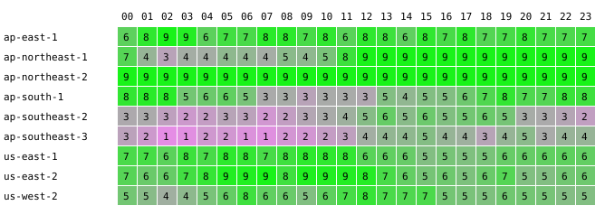

# Spot placement score log

Generated 2026-11-26 23:45 UTC. Scores are 1–10; a region counts as available at ≥ 5. The single-type set is scored low by design (EC2 wants three or more instance types); read it relative to itself over time and use the trio set as the calibrated reference.

## g5.xlarge (g5.xlarge)

| region | samples | hours ≥ 5 | mean score | latest |
|---|---|---|---|---|
| ap-east-1 | 573 | 46% | 5.0 | 1 (11-26 23:45Z) |
| ap-northeast-1 | 573 | 18% | 2.8 | 1 (11-26 23:45Z) |
| ap-northeast-2 | 573 | 68% | 7.0 | 1 (11-26 23:45Z) |
| ap-south-1 | 573 | 3% | 1.7 | 2 (11-26 23:45Z) |
| ap-southeast-2 | 573 | 1% | 1.0 | 1 (11-26 23:45Z) |
| ap-southeast-3 | 573 | 22% | 3.0 | 1 (11-26 23:45Z) |
| us-east-1 | 573 | 13% | 2.8 | 3 (11-26 23:45Z) |
| us-east-2 | 573 | 30% | 3.6 | 1 (11-26 23:45Z) |
| us-west-2 | 573 | 9% | 2.1 | 1 (11-26 23:45Z) |

### Last 48 samples

```
region           oldest → newest (48 h, one char per sample)
ap-east-1        111111119919961139119111111111111111111111111191
ap-northeast-1   112112999599999119121122121129999912921111119121
ap-northeast-2   111111119999999979917169199919999111111999991191
ap-south-1       111111111119111111111111111111119112112211112122
ap-southeast-2   111111111111111111111111111111111111111111111111
ap-southeast-3   111111111121131113111111111111111111111111111111
us-east-1        323334422332373746546765465656675446545544453543
us-east-2        111111111991991999111991811111111111111111911111
us-west-2        111212211121911112112121211211152131911212112321
```

### Mean score by UTC hour

| region | 00 | 01 | 02 | 03 | 04 | 05 | 06 | 07 | 08 | 09 | 10 | 11 | 12 | 13 | 14 | 15 | 16 | 17 | 18 | 19 | 20 | 21 | 22 | 23 |
|---|---|---|---|---|---|---|---|---|---|---|---|---|---|---|---|---|---|---|---|---|---|---|---|---|
| ap-east-1 | 4 | 5 | 5 | 4 | 5 | 4 | 5 | 7 | 5 | 6 | 7 | 5 | 6 | 6 | 5 | 6 | 5 | 6 | 5 | 5 | 5 | 3 | 5 | 5 |
| ap-northeast-1 | 3 | 2 | 2 | 2 | 2 | 2 | 2 | 1 | 1 | 2 | 2 | 2 | 3 | 4 | 4 | 5 | 5 | 3 | 2 | 3 | 4 | 4 | 3 | 2 |
| ap-northeast-2 | 6 | 8 | 8 | 7 | 6 | 7 | 6 | 8 | 8 | 7 | 8 | 6 | 8 | 7 | 6 | 8 | 7 | 8 | 6 | 7 | 8 | 7 | 6 | 7 |
| ap-south-1 | 2 | 2 | 2 | 1 | 2 | 1 | 2 | 1 | 1 | 1 | 1 | 1 | 1 | 2 | 2 | 1 | 1 | 2 | 2 | 2 | 2 | 2 | 2 | 2 |
| ap-southeast-2 | 1 | 1 | 1 | 1 | 1 | 1 | 1 | 1 | 1 | 1 | 1 | 1 | 1 | 1 | 1 | 1 | 1 | 1 | 1 | 1 | 1 | 1 | 1 | 1 |
| ap-southeast-3 | 3 | 2 | 1 | 1 | 2 | 2 | 1 | 1 | 2 | 2 | 2 | 3 | 3 | 4 | 4 | 5 | 4 | 4 | 3 | 4 | 5 | 3 | 4 | 4 |
| us-east-1 | 3 | 3 | 2 | 4 | 3 | 3 | 4 | 3 | 3 | 2 | 3 | 3 | 3 | 3 | 3 | 2 | 2 | 2 | 3 | 2 | 2 | 3 | 3 | 3 |
| us-east-2 | 3 | 4 | 3 | 3 | 3 | 5 | 5 | 7 | 4 | 5 | 6 | 3 | 4 | 3 | 2 | 3 | 3 | 3 | 3 | 4 | 3 | 3 | 3 | 3 |
| us-west-2 | 2 | 2 | 2 | 2 | 2 | 2 | 3 | 2 | 3 | 2 | 2 | 2 | 2 | 3 | 2 | 2 | 2 | 2 | 1 | 2 | 2 | 2 | 2 | 2 |


### Best single AZ per sample

| region | samples | hours ≥ 5 | mean score | latest |
|---|---|---|---|---|
| ap-east-1 ape1-az1 | 176 | 5% | 1.5 | 1 (11-26 15:01Z) |
| ap-east-1 ape1-az2 | 403 | 66% | 6.6 | 9 (11-26 15:01Z) |
| ap-northeast-1 apne1-az1 | 141 | 11% | 1.9 | 1 (11-26 23:45Z) |
| ap-northeast-1 apne1-az4 | 270 | 29% | 3.6 | 1 (11-26 04:56Z) |
| ap-northeast-2 apne2-az1 | 475 | 63% | 6.6 | 1 (11-26 04:56Z) |
| ap-northeast-2 apne2-az3 | 522 | 68% | 6.9 | 1 (11-26 23:45Z) |
| ap-northeast-2 apne2-az4 | 553 | 70% | 7.1 | 1 (11-26 23:45Z) |
| ap-south-1 aps1-az1 | 171 | 2% | 1.4 | 1 (11-26 15:01Z) |
| ap-south-1 aps1-az3 | 167 | 7% | 2.3 | 1 (11-26 23:45Z) |
| ap-southeast-2 apse2-az1 | 120 | 2% | 1.2 | 1 (11-26 23:45Z) |
| ap-southeast-2 apse2-az2 | 87 | 0% | 1.0 | 1 (11-26 23:45Z) |
| ap-southeast-3 apse3-az1 | 104 | 0% | 1.0 | 1 (11-26 04:56Z) |
| ap-southeast-3 apse3-az3 | 339 | 36% | 4.2 | 1 (11-26 23:45Z) |
| us-east-1 use1-az1 | 130 | 0% | 1.0 | 1 (11-26 23:45Z) |
| us-east-1 use1-az2 | 149 | 3% | 1.4 | 1 (11-26 15:01Z) |
| us-east-1 use1-az4 | 199 | 19% | 2.8 | 1 (11-26 15:01Z) |
| us-east-1 use1-az5 | 184 | 23% | 3.0 | 1 (11-26 23:45Z) |
| us-east-1 use1-az6 | 149 | 21% | 2.8 | 1 (11-26 15:01Z) |
| us-east-2 use2-az1 | 246 | 42% | 4.5 | 1 (11-26 15:01Z) |
| us-east-2 use2-az2 | 288 | 51% | 5.3 | 9 (11-25 02:18Z) |
| us-east-2 use2-az3 | 313 | 48% | 5.1 | 1 (11-26 04:56Z) |
| us-west-2 usw2-az1 | 184 | 21% | 2.9 | 2 (11-26 04:56Z) |
| us-west-2 usw2-az2 | 140 | 15% | 2.4 | 1 (11-26 23:45Z) |
| us-west-2 usw2-az3 | 220 | 16% | 2.6 | 1 (11-26 15:01Z) |

## g-xlarge-trio (g5.xlarge, g4dn.xlarge, g6.xlarge)

| region | samples | hours ≥ 5 | mean score | latest |
|---|---|---|---|---|
| ap-east-1 | 573 | 73% | 7.4 | 9 (11-26 23:45Z) |
| ap-northeast-1 | 573 | 73% | 7.0 | 9 (11-26 23:45Z) |
| ap-northeast-2 | 573 | 100% | 9.0 | 9 (11-26 23:45Z) |
| ap-south-1 | 573 | 57% | 5.9 | 9 (11-26 23:45Z) |
| ap-southeast-2 | 573 | 28% | 3.7 | 9 (11-26 23:45Z) |
| ap-southeast-3 | 573 | 22% | 3.0 | 1 (11-26 23:45Z) |
| us-east-1 | 573 | 74% | 6.6 | 9 (11-26 23:45Z) |
| us-east-2 | 573 | 68% | 6.7 | 2 (11-26 23:45Z) |
| us-west-2 | 573 | 52% | 5.7 | 9 (11-26 23:45Z) |

### Last 48 samples

```
region           oldest → newest (48 h, one char per sample)
ap-east-1        999999999999999999999999999999999999999999999999
ap-northeast-1   289429999999999229299199399199999999999929199199
ap-northeast-2   999999999999999999999999999999999999999999999999
ap-south-1       111911111199111111111111111111119112112214115129
ap-southeast-2   199119132999991118191191199119999919991919191199
ap-southeast-3   111111111121131113111111111111111111111111111111
us-east-1        896697899999799999888988888889999989999878887889
us-east-2        999999999999991999958992991993291119949399933992
us-west-2        343419423993999115995453532444499569999596994999
```

### Mean score by UTC hour

| region | 00 | 01 | 02 | 03 | 04 | 05 | 06 | 07 | 08 | 09 | 10 | 11 | 12 | 13 | 14 | 15 | 16 | 17 | 18 | 19 | 20 | 21 | 22 | 23 |
|---|---|---|---|---|---|---|---|---|---|---|---|---|---|---|---|---|---|---|---|---|---|---|---|---|
| ap-east-1 | 6 | 8 | 9 | 9 | 6 | 7 | 7 | 8 | 8 | 7 | 8 | 6 | 8 | 8 | 6 | 8 | 7 | 8 | 7 | 7 | 8 | 7 | 7 | 7 |
| ap-northeast-1 | 7 | 4 | 3 | 4 | 3 | 4 | 4 | 4 | 5 | 4 | 5 | 8 | 9 | 9 | 9 | 9 | 9 | 9 | 9 | 9 | 9 | 9 | 9 | 9 |
| ap-northeast-2 | 9 | 9 | 9 | 9 | 9 | 9 | 9 | 9 | 9 | 9 | 9 | 9 | 9 | 9 | 9 | 9 | 9 | 9 | 9 | 9 | 9 | 9 | 9 | 9 |
| ap-south-1 | 8 | 8 | 8 | 5 | 6 | 6 | 5 | 3 | 3 | 3 | 3 | 3 | 3 | 5 | 4 | 5 | 5 | 6 | 7 | 8 | 7 | 7 | 8 | 8 |
| ap-southeast-2 | 3 | 3 | 2 | 2 | 2 | 3 | 3 | 2 | 2 | 3 | 3 | 4 | 5 | 6 | 5 | 6 | 5 | 6 | 6 | 5 | 3 | 3 | 3 | 3 |
| ap-southeast-3 | 3 | 2 | 1 | 1 | 2 | 2 | 1 | 1 | 2 | 2 | 2 | 3 | 3 | 4 | 4 | 5 | 4 | 4 | 3 | 4 | 5 | 3 | 4 | 4 |
| us-east-1 | 7 | 7 | 7 | 8 | 7 | 8 | 8 | 7 | 8 | 8 | 8 | 8 | 7 | 6 | 6 | 5 | 5 | 5 | 5 | 6 | 6 | 6 | 6 | 6 |
| us-east-2 | 7 | 6 | 6 | 7 | 8 | 9 | 9 | 9 | 8 | 9 | 9 | 9 | 8 | 7 | 6 | 6 | 6 | 5 | 6 | 7 | 5 | 5 | 5 | 6 |
| us-west-2 | 5 | 5 | 4 | 4 | 5 | 6 | 8 | 6 | 6 | 5 | 6 | 7 | 8 | 7 | 7 | 7 | 5 | 5 | 5 | 6 | 5 | 5 | 5 | 5 |



### Best single AZ per sample

| region | samples | hours ≥ 5 | mean score | latest |
|---|---|---|---|---|
| ap-east-1 ape1-az1 | 375 | 86% | 8.1 | 9 (11-26 23:45Z) |
| ap-east-1 ape1-az2 | 336 | 88% | 8.3 | 9 (11-26 04:56Z) |
| ap-east-1 ape1-az3 | 372 | 88% | 8.3 | 9 (11-26 23:45Z) |
| ap-northeast-1 apne1-az1 | 229 | 95% | 8.7 | 9 (11-25 22:26Z) |
| ap-northeast-1 apne1-az2 | 218 | 88% | 8.2 | 9 (11-26 23:45Z) |
| ap-northeast-1 apne1-az4 | 296 | 99% | 8.9 | 9 (11-26 23:45Z) |
| ap-northeast-2 apne2-az1 | 461 | 100% | 9.0 | 9 (11-26 15:01Z) |
| ap-northeast-2 apne2-az2 | 129 | 88% | 8.2 | 9 (11-23 21:14Z) |
| ap-northeast-2 apne2-az3 | 483 | 100% | 9.0 | 9 (11-26 15:01Z) |
| ap-northeast-2 apne2-az4 | 378 | 88% | 8.2 | 9 (11-26 23:45Z) |
| ap-south-1 aps1-az1 | 180 | 88% | 8.3 | 9 (11-21 17:22Z) |
| ap-south-1 aps1-az2 | 189 | 80% | 7.8 | 9 (11-26 23:45Z) |
| ap-south-1 aps1-az3 | 203 | 90% | 8.4 | 9 (11-26 23:45Z) |
| ap-southeast-2 apse2-az1 | 84 | 88% | 8.2 | 9 (11-26 23:45Z) |
| ap-southeast-2 apse2-az2 | 3 | 67% | 7.0 | 9 (10-31 19:10Z) |
| ap-southeast-2 apse2-az3 | 96 | 85% | 8.1 | 9 (11-25 12:40Z) |
| ap-southeast-3 apse3-az1 | 1 | 0% | 1.0 | 1 (11-26 04:56Z) |
| ap-southeast-3 apse3-az3 | 74 | 39% | 5.2 | 9 (10-31 22:12Z) |
| us-east-1 use1-az1 | 31 | 52% | 5.5 | 2 (11-26 04:56Z) |
| us-east-1 use1-az2 | 123 | 99% | 9.0 | 9 (11-23 08:55Z) |
| us-east-1 use1-az4 | 162 | 90% | 8.3 | 3 (11-26 04:56Z) |
| us-east-1 use1-az5 | 117 | 98% | 8.9 | 9 (11-23 00:46Z) |
| us-east-1 use1-az6 | 145 | 93% | 8.5 | 9 (11-26 23:45Z) |
| us-east-2 use2-az1 | 207 | 99% | 8.9 | 9 (11-26 15:01Z) |
| us-east-2 use2-az2 | 224 | 99% | 8.9 | 9 (11-26 15:01Z) |
| us-east-2 use2-az3 | 249 | 97% | 8.8 | 9 (11-26 15:01Z) |
| us-west-2 usw2-az1 | 112 | 98% | 8.9 | 9 (11-26 04:56Z) |
| us-west-2 usw2-az2 | 100 | 91% | 8.4 | 9 (11-26 23:45Z) |
| us-west-2 usw2-az3 | 153 | 88% | 8.2 | 9 (11-26 15:01Z) |

## Latest spot prices

| region | az | product | $/h | sampled |
|---|---|---|---|---|
| ap-northeast-1 | ap-northeast-1a | Linux/UNIX | 0.708300 | 2026-11-26T23:45:46Z |
| ap-northeast-1 | ap-northeast-1a | Windows | 0.840600 | 2026-11-26T23:45:46Z |
| ap-northeast-1 | ap-northeast-1c | Linux/UNIX | 0.730900 | 2026-11-26T23:45:46Z |
| ap-northeast-1 | ap-northeast-1c | Windows | 0.840600 | 2026-11-26T23:45:46Z |
| ap-northeast-2 | ap-northeast-2a | Linux/UNIX | 0.609400 | 2026-11-26T23:45:46Z |
| ap-northeast-2 | ap-northeast-2a | Windows | 0.740700 | 2026-11-26T23:45:46Z |
| ap-northeast-2 | ap-northeast-2c | Linux/UNIX | 0.625600 | 2026-11-26T23:45:46Z |
| ap-northeast-2 | ap-northeast-2c | Windows | 0.740700 | 2026-11-26T23:45:46Z |
| ap-northeast-2 | ap-northeast-2d | Linux/UNIX | 0.605700 | 2026-11-26T23:45:46Z |
| ap-northeast-2 | ap-northeast-2d | Windows | 0.740700 | 2026-11-26T23:45:46Z |
| ap-south-1 | ap-south-1a | Linux/UNIX | 0.769300 | 2026-11-26T23:45:46Z |
| ap-south-1 | ap-south-1a | Windows | 0.396400 | 2026-11-26T23:45:46Z |
| ap-south-1 | ap-south-1b | Linux/UNIX | 0.690300 | 2026-11-26T23:45:46Z |
| ap-south-1 | ap-south-1b | Windows | 0.403300 | 2026-11-26T23:45:46Z |
| ap-southeast-2 | ap-southeast-2a | Linux/UNIX | 0.689900 | 2026-11-26T23:45:46Z |
| ap-southeast-2 | ap-southeast-2a | Windows | 0.508500 | 2026-11-26T23:45:46Z |
| ap-southeast-2 | ap-southeast-2c | Linux/UNIX | 0.564200 | 2026-11-26T23:45:46Z |
| ap-southeast-2 | ap-southeast-2c | Windows | 0.522400 | 2026-11-26T23:45:46Z |
| us-east-1 | us-east-1a | Linux/UNIX | 0.801300 | 2026-11-26T23:45:46Z |
| us-east-1 | us-east-1a | Windows | 0.284600 | 2026-11-26T23:45:46Z |
| us-east-1 | us-east-1b | Linux/UNIX | 0.904600 | 2026-11-26T23:45:46Z |
| us-east-1 | us-east-1b | Windows | 0.340100 | 2026-11-26T23:45:46Z |
| us-east-1 | us-east-1c | Linux/UNIX | 0.850000 | 2026-11-26T23:45:46Z |
| us-east-1 | us-east-1c | Windows | 0.284600 | 2026-11-26T23:45:46Z |
| us-east-1 | us-east-1d | Linux/UNIX | 0.859900 | 2026-11-26T23:45:46Z |
| us-east-1 | us-east-1d | Windows | 0.284600 | 2026-11-26T23:45:46Z |
| us-east-1 | us-east-1f | Linux/UNIX | 0.864200 | 2026-11-26T23:45:46Z |
| us-east-1 | us-east-1f | Windows | 0.284600 | 2026-11-26T23:45:46Z |
| us-east-2 | us-east-2a | Linux/UNIX | 0.542700 | 2026-11-26T23:45:46Z |
| us-east-2 | us-east-2a | Windows | 0.636700 | 2026-11-26T23:45:46Z |
| us-east-2 | us-east-2b | Linux/UNIX | 0.553200 | 2026-11-26T23:45:46Z |
| us-east-2 | us-east-2b | Windows | 0.636700 | 2026-11-26T23:45:46Z |
| us-east-2 | us-east-2c | Linux/UNIX | 0.547500 | 2026-11-26T23:45:46Z |
| us-east-2 | us-east-2c | Windows | 0.636700 | 2026-11-26T23:45:46Z |
| us-west-2 | us-west-2a | Linux/UNIX | 0.608800 | 2026-11-26T23:45:46Z |
| us-west-2 | us-west-2a | Windows | 0.293400 | 2026-11-26T23:45:46Z |
| us-west-2 | us-west-2b | Linux/UNIX | 0.905700 | 2026-11-26T23:45:46Z |
| us-west-2 | us-west-2b | Windows | 0.284600 | 2026-11-26T23:45:46Z |
| us-west-2 | us-west-2c | Linux/UNIX | 0.536300 | 2026-11-26T23:45:46Z |
| us-west-2 | us-west-2c | Windows | 0.284600 | 2026-11-26T23:45:46Z |
