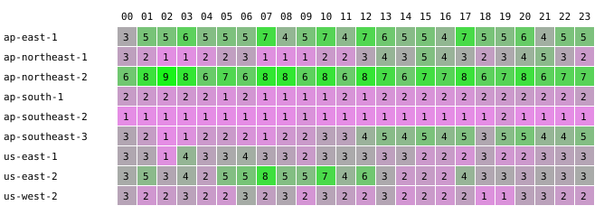
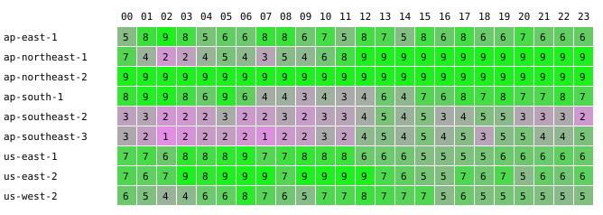

# Spot placement score log

Generated 2026-10-15 13:21 UTC. Scores are 1–10; a region counts as available at ≥ 5. The single-type set is scored low by design (EC2 wants three or more instance types); read it relative to itself over time and use the trio set as the calibrated reference.

## g5.xlarge (g5.xlarge)

| region | samples | hours ≥ 5 | mean score | latest |
|---|---|---|---|---|
| ap-east-1 | 315 | 36% | 4.4 | 9 (10-15 13:20Z) |
| ap-northeast-1 | 315 | 15% | 2.7 | 4 (10-15 13:20Z) |
| ap-northeast-2 | 315 | 50% | 6.0 | 9 (10-15 13:20Z) |
| ap-south-1 | 315 | 2% | 1.8 | 2 (10-15 13:20Z) |
| ap-southeast-2 | 315 | 0% | 1.0 | 1 (10-15 13:20Z) |
| ap-southeast-3 | 315 | 22% | 3.2 | 5 (10-15 13:20Z) |
| us-east-1 | 315 | 9% | 2.5 | 3 (10-15 13:20Z) |
| us-east-2 | 315 | 27% | 3.6 | 1 (10-15 13:20Z) |
| us-west-2 | 315 | 11% | 2.4 | 2 (10-15 13:20Z) |

### Last 48 samples

```
region           oldest → newest (48 h, one char per sample)
ap-east-1        812111111111111111111111182292999999999999999999
ap-northeast-1   999911911115119711111191112222119221212111422114
ap-northeast-2   999991499999999999999999199999999999999999999999
ap-south-1       112222222222222211122111111222222222211111222222
ap-southeast-2   111111111111111111111111111111111111111111111111
ap-southeast-3   111111111111138811111389119997939515112211113115
us-east-1        199999211112111122211323233319223322211333323213
us-east-2        999999111811111111111111118119999991111299111291
us-west-2        991991121121211111111111199991111111111111111112
```

### Mean score by UTC hour

| region | 00 | 01 | 02 | 03 | 04 | 05 | 06 | 07 | 08 | 09 | 10 | 11 | 12 | 13 | 14 | 15 | 16 | 17 | 18 | 19 | 20 | 21 | 22 | 23 |
|---|---|---|---|---|---|---|---|---|---|---|---|---|---|---|---|---|---|---|---|---|---|---|---|---|
| ap-east-1 | 2 | 5 | 5 | 7 | 3 | 4 | 4 | 7 | 4 | 5 | 6 | 4 | 7 | 6 | 4 | 4 | 3 | 6 | 4 | 4 | 5 | 3 | 5 | 4 |
| ap-northeast-1 | 2 | 2 | 1 | 1 | 2 | 2 | 3 | 1 | 1 | 2 | 2 | 2 | 4 | 4 | 3 | 6 | 4 | 4 | 2 | 3 | 4 | 4 | 3 | 2 |
| ap-northeast-2 | 4 | 7 | 9 | 8 | 4 | 6 | 5 | 8 | 8 | 6 | 7 | 5 | 7 | 7 | 5 | 6 | 6 | 7 | 6 | 6 | 6 | 6 | 6 | 5 |
| ap-south-1 | 2 | 2 | 2 | 2 | 2 | 1 | 1 | 1 | 1 | 1 | 1 | 2 | 1 | 2 | 2 | 1 | 2 | 2 | 2 | 2 | 2 | 2 | 2 | 2 |
| ap-southeast-2 | 1 | 1 | 1 | 1 | 1 | 1 | 1 | 1 | 1 | 1 | 1 | 1 | 1 | 1 | 1 | 1 | 1 | 1 | 1 | 1 | 1 | 1 | 1 | 1 |
| ap-southeast-3 | 3 | 2 | 1 | 2 | 2 | 3 | 2 | 1 | 2 | 2 | 4 | 3 | 4 | 5 | 4 | 5 | 4 | 5 | 3 | 4 | 4 | 4 | 4 | 5 |
| us-east-1 | 3 | 3 | 1 | 6 | 3 | 4 | 4 | 3 | 3 | 2 | 4 | 3 | 3 | 2 | 2 | 2 | 2 | 2 | 2 | 2 | 2 | 3 | 3 | 3 |
| us-east-2 | 3 | 5 | 4 | 3 | 2 | 4 | 5 | 7 | 5 | 4 | 6 | 4 | 6 | 4 | 2 | 3 | 1 | 4 | 2 | 4 | 2 | 3 | 3 | 3 |
| us-west-2 | 3 | 2 | 2 | 3 | 2 | 2 | 3 | 3 | 3 | 2 | 3 | 3 | 2 | 3 | 2 | 2 | 1 | 3 | 1 | 1 | 3 | 2 | 2 | 2 |



### Best single AZ per sample

| region | samples | hours ≥ 5 | mean score | latest |
|---|---|---|---|---|
| ap-east-1 ape1-az1 | 110 | 8% | 1.8 | 1 (10-15 13:20Z) |
| ap-east-1 ape1-az2 | 220 | 51% | 5.7 | 9 (10-15 13:20Z) |
| ap-northeast-1 apne1-az1 | 53 | 8% | 1.8 | 3 (10-14 13:38Z) |
| ap-northeast-1 apne1-az4 | 149 | 26% | 3.6 | 2 (10-15 13:20Z) |
| ap-northeast-2 apne2-az1 | 275 | 48% | 5.8 | 9 (10-15 13:20Z) |
| ap-northeast-2 apne2-az3 | 287 | 51% | 6.0 | 9 (10-15 13:20Z) |
| ap-northeast-2 apne2-az4 | 312 | 51% | 6.0 | 9 (10-15 13:20Z) |
| ap-south-1 aps1-az1 | 83 | 1% | 1.6 | 1 (10-14 18:31Z) |
| ap-south-1 aps1-az3 | 109 | 3% | 2.4 | 1 (10-14 22:14Z) |
| ap-southeast-2 apse2-az1 | 50 | 0% | 1.1 | 1 (10-15 01:24Z) |
| ap-southeast-2 apse2-az2 | 33 | 0% | 1.0 | 1 (10-14 13:38Z) |
| ap-southeast-3 apse3-az1 | 62 | 0% | 1.0 | 1 (10-15 13:20Z) |
| ap-southeast-3 apse3-az3 | 211 | 31% | 4.2 | 5 (10-15 13:20Z) |
| us-east-1 use1-az1 | 62 | 0% | 1.1 | 1 (10-14 13:38Z) |
| us-east-1 use1-az2 | 85 | 4% | 1.5 | 1 (10-15 13:20Z) |
| us-east-1 use1-az4 | 98 | 27% | 3.4 | 1 (10-14 07:30Z) |
| us-east-1 use1-az5 | 98 | 24% | 3.2 | 1 (10-15 01:24Z) |
| us-east-1 use1-az6 | 74 | 20% | 2.9 | 1 (10-12 18:57Z) |
| us-east-2 use2-az1 | 126 | 39% | 4.4 | 9 (10-14 07:30Z) |
| us-east-2 use2-az2 | 160 | 44% | 4.9 | 1 (10-15 13:20Z) |
| us-east-2 use2-az3 | 190 | 43% | 4.9 | 9 (10-15 07:20Z) |
| us-west-2 usw2-az1 | 109 | 28% | 3.7 | 1 (10-15 07:20Z) |
| us-west-2 usw2-az2 | 67 | 25% | 3.4 | 1 (10-14 13:38Z) |
| us-west-2 usw2-az3 | 127 | 22% | 3.3 | 1 (10-14 07:30Z) |

## g-xlarge-trio (g5.xlarge, g4dn.xlarge, g6.xlarge)

| region | samples | hours ≥ 5 | mean score | latest |
|---|---|---|---|---|
| ap-east-1 | 315 | 51% | 6.1 | 9 (10-15 13:20Z) |
| ap-northeast-1 | 315 | 73% | 7.1 | 9 (10-15 13:20Z) |
| ap-northeast-2 | 315 | 100% | 9.0 | 9 (10-15 13:20Z) |
| ap-south-1 | 315 | 60% | 6.3 | 2 (10-15 13:20Z) |
| ap-southeast-2 | 315 | 17% | 3.1 | 1 (10-15 13:20Z) |
| ap-southeast-3 | 315 | 22% | 3.2 | 5 (10-15 13:20Z) |
| us-east-1 | 315 | 71% | 6.5 | 5 (10-15 13:20Z) |
| us-east-2 | 315 | 71% | 6.9 | 1 (10-15 13:20Z) |
| us-west-2 | 315 | 52% | 5.7 | 5 (10-15 13:20Z) |

### Last 48 samples

```
region           oldest → newest (48 h, one char per sample)
ap-east-1        999999999999999999999999999999999999999999999999
ap-northeast-1   999991992399139911991199999999999999239923999219
ap-northeast-2   999999999999999999999999999999999999999999999999
ap-south-1       999992299299929991999149999999999929919991229922
ap-southeast-2   299922911111119111111118919999991111111111181111
ap-southeast-3   111111111111138811111389119997939515112211113115
us-east-1        999999554533433366354645699829999994542666435555
us-east-2        999999239933212121112121199229999991191299112291
us-west-2        999999432354413233313323399999935929944249534335
```

### Mean score by UTC hour

| region | 00 | 01 | 02 | 03 | 04 | 05 | 06 | 07 | 08 | 09 | 10 | 11 | 12 | 13 | 14 | 15 | 16 | 17 | 18 | 19 | 20 | 21 | 22 | 23 |
|---|---|---|---|---|---|---|---|---|---|---|---|---|---|---|---|---|---|---|---|---|---|---|---|---|
| ap-east-1 | 4 | 8 | 9 | 8 | 5 | 6 | 6 | 8 | 8 | 6 | 7 | 5 | 7 | 7 | 5 | 7 | 6 | 7 | 6 | 6 | 6 | 6 | 6 | 5 |
| ap-northeast-1 | 7 | 4 | 2 | 2 | 4 | 5 | 4 | 3 | 5 | 4 | 6 | 8 | 9 | 9 | 9 | 9 | 9 | 9 | 9 | 9 | 9 | 9 | 9 | 9 |
| ap-northeast-2 | 9 | 9 | 9 | 9 | 9 | 9 | 9 | 9 | 9 | 9 | 9 | 9 | 9 | 9 | 9 | 9 | 9 | 9 | 9 | 9 | 9 | 9 | 9 | 9 |
| ap-south-1 | 8 | 9 | 9 | 8 | 6 | 8 | 6 | 4 | 4 | 2 | 4 | 3 | 4 | 6 | 4 | 6 | 7 | 8 | 7 | 8 | 7 | 7 | 8 | 6 |
| ap-southeast-2 | 2 | 3 | 2 | 2 | 2 | 3 | 2 | 3 | 3 | 2 | 2 | 3 | 4 | 5 | 4 | 5 | 4 | 4 | 5 | 4 | 3 | 3 | 3 | 2 |
| ap-southeast-3 | 3 | 2 | 1 | 2 | 2 | 3 | 2 | 1 | 2 | 2 | 4 | 3 | 4 | 5 | 4 | 5 | 4 | 5 | 3 | 4 | 4 | 4 | 4 | 5 |
| us-east-1 | 7 | 7 | 6 | 8 | 8 | 9 | 9 | 6 | 7 | 8 | 8 | 8 | 6 | 6 | 5 | 5 | 5 | 5 | 5 | 6 | 6 | 6 | 6 | 6 |
| us-east-2 | 7 | 6 | 7 | 9 | 9 | 9 | 9 | 9 | 7 | 9 | 9 | 9 | 9 | 7 | 6 | 6 | 5 | 7 | 6 | 7 | 5 | 6 | 6 | 6 |
| us-west-2 | 6 | 5 | 4 | 4 | 5 | 6 | 8 | 7 | 6 | 5 | 7 | 7 | 8 | 7 | 6 | 7 | 5 | 6 | 5 | 5 | 5 | 5 | 4 | 5 |



### Best single AZ per sample

| region | samples | hours ≥ 5 | mean score | latest |
|---|---|---|---|---|
| ap-east-1 ape1-az1 | 190 | 72% | 7.3 | 9 (10-15 13:20Z) |
| ap-east-1 ape1-az2 | 159 | 74% | 7.5 | 9 (10-15 13:20Z) |
| ap-east-1 ape1-az3 | 160 | 72% | 7.3 | 9 (10-15 13:20Z) |
| ap-northeast-1 apne1-az1 | 149 | 93% | 8.5 | 9 (10-15 13:20Z) |
| ap-northeast-1 apne1-az2 | 88 | 69% | 7.1 | 9 (10-15 13:20Z) |
| ap-northeast-1 apne1-az4 | 179 | 98% | 8.9 | 9 (10-15 13:20Z) |
| ap-northeast-2 apne2-az1 | 249 | 100% | 9.0 | 9 (10-15 13:20Z) |
| ap-northeast-2 apne2-az2 | 68 | 78% | 7.6 | 9 (10-14 18:31Z) |
| ap-northeast-2 apne2-az3 | 270 | 100% | 9.0 | 9 (10-15 13:20Z) |
| ap-northeast-2 apne2-az4 | 184 | 74% | 7.5 | 9 (10-15 13:20Z) |
| ap-south-1 aps1-az1 | 109 | 80% | 7.8 | 9 (10-14 01:49Z) |
| ap-south-1 aps1-az2 | 111 | 68% | 7.0 | 9 (10-15 01:24Z) |
| ap-south-1 aps1-az3 | 128 | 85% | 8.1 | 3 (10-15 01:24Z) |
| ap-southeast-2 apse2-az1 | 24 | 58% | 6.4 | 9 (10-07 16:22Z) |
| ap-southeast-2 apse2-az2 | 1 | 0% | 3.0 | 3 (09-04 18:19Z) |
| ap-southeast-2 apse2-az3 | 38 | 66% | 6.9 | 9 (10-11 12:40Z) |
| ap-southeast-3 apse3-az3 | 62 | 31% | 4.7 | 5 (10-15 13:20Z) |
| us-east-1 use1-az1 | 21 | 57% | 5.9 | 2 (10-15 01:24Z) |
| us-east-1 use1-az2 | 80 | 100% | 9.0 | 9 (10-11 05:37Z) |
| us-east-1 use1-az4 | 102 | 94% | 8.6 | 2 (10-15 07:20Z) |
| us-east-1 use1-az5 | 62 | 97% | 8.8 | 9 (10-11 21:50Z) |
| us-east-1 use1-az6 | 83 | 95% | 8.7 | 9 (10-12 01:14Z) |
| us-east-2 use2-az1 | 107 | 98% | 8.9 | 9 (10-15 07:20Z) |
| us-east-2 use2-az2 | 152 | 99% | 8.9 | 9 (10-15 07:20Z) |
| us-east-2 use2-az3 | 141 | 94% | 8.6 | 9 (10-15 07:20Z) |
| us-west-2 usw2-az1 | 75 | 97% | 8.8 | 9 (10-13 01:16Z) |
| us-west-2 usw2-az2 | 69 | 96% | 8.7 | 9 (10-11 05:37Z) |
| us-west-2 usw2-az3 | 89 | 94% | 8.6 | 2 (10-13 09:19Z) |

## Latest spot prices

| region | az | product | $/h | sampled |
|---|---|---|---|---|
| ap-northeast-1 | ap-northeast-1a | Linux/UNIX | 0.714100 | 2026-10-15T13:20:53Z |
| ap-northeast-1 | ap-northeast-1a | Windows | 0.840600 | 2026-10-15T13:20:53Z |
| ap-northeast-1 | ap-northeast-1c | Linux/UNIX | 0.762700 | 2026-10-15T13:20:53Z |
| ap-northeast-1 | ap-northeast-1c | Windows | 0.941800 | 2026-10-15T13:20:53Z |
| ap-northeast-2 | ap-northeast-2a | Linux/UNIX | 0.588600 | 2026-10-15T13:20:53Z |
| ap-northeast-2 | ap-northeast-2a | Windows | 0.740700 | 2026-10-15T13:20:53Z |
| ap-northeast-2 | ap-northeast-2c | Linux/UNIX | 0.585500 | 2026-10-15T13:20:53Z |
| ap-northeast-2 | ap-northeast-2c | Windows | 0.740700 | 2026-10-15T13:20:53Z |
| ap-northeast-2 | ap-northeast-2d | Linux/UNIX | 0.572400 | 2026-10-15T13:20:53Z |
| ap-northeast-2 | ap-northeast-2d | Windows | 0.741600 | 2026-10-15T13:20:53Z |
| ap-south-1 | ap-south-1a | Linux/UNIX | 0.554100 | 2026-10-15T13:20:53Z |
| ap-south-1 | ap-south-1a | Windows | 0.378300 | 2026-10-15T13:20:53Z |
| ap-south-1 | ap-south-1b | Linux/UNIX | 0.701800 | 2026-10-15T13:20:53Z |
| ap-south-1 | ap-south-1b | Windows | 0.329000 | 2026-10-15T13:20:53Z |
| ap-southeast-2 | ap-southeast-2a | Linux/UNIX | 0.724300 | 2026-10-15T13:20:53Z |
| ap-southeast-2 | ap-southeast-2a | Windows | 0.524900 | 2026-10-15T13:20:53Z |
| ap-southeast-2 | ap-southeast-2c | Linux/UNIX | 0.521300 | 2026-10-15T13:20:53Z |
| ap-southeast-2 | ap-southeast-2c | Windows | 0.598800 | 2026-10-15T13:20:53Z |
| us-east-1 | us-east-1a | Linux/UNIX | 0.472900 | 2026-10-15T13:20:53Z |
| us-east-1 | us-east-1a | Windows | 0.284600 | 2026-10-15T13:20:53Z |
| us-east-1 | us-east-1b | Linux/UNIX | 0.506400 | 2026-10-15T13:20:53Z |
| us-east-1 | us-east-1b | Windows | 0.284600 | 2026-10-15T13:20:53Z |
| us-east-1 | us-east-1c | Linux/UNIX | 0.458600 | 2026-10-15T13:20:53Z |
| us-east-1 | us-east-1c | Windows | 0.284600 | 2026-10-15T13:20:53Z |
| us-east-1 | us-east-1d | Linux/UNIX | 0.417600 | 2026-10-15T13:20:53Z |
| us-east-1 | us-east-1d | Windows | 0.284600 | 2026-10-15T13:20:53Z |
| us-east-1 | us-east-1f | Linux/UNIX | 0.452400 | 2026-10-15T13:20:53Z |
| us-east-1 | us-east-1f | Windows | 0.284600 | 2026-10-15T13:20:53Z |
| us-east-2 | us-east-2a | Linux/UNIX | 0.543800 | 2026-10-15T13:20:53Z |
| us-east-2 | us-east-2a | Windows | 0.643900 | 2026-10-15T13:20:53Z |
| us-east-2 | us-east-2b | Linux/UNIX | 0.534100 | 2026-10-15T13:20:53Z |
| us-east-2 | us-east-2b | Windows | 0.640700 | 2026-10-15T13:20:53Z |
| us-east-2 | us-east-2c | Linux/UNIX | 0.528300 | 2026-10-15T13:20:53Z |
| us-east-2 | us-east-2c | Windows | 0.637700 | 2026-10-15T13:20:53Z |
| us-west-2 | us-west-2a | Linux/UNIX | 0.532900 | 2026-10-15T13:20:53Z |
| us-west-2 | us-west-2a | Windows | 0.315800 | 2026-10-15T13:20:53Z |
| us-west-2 | us-west-2b | Linux/UNIX | 0.499500 | 2026-10-15T13:20:53Z |
| us-west-2 | us-west-2b | Windows | 0.330700 | 2026-10-15T13:20:53Z |
| us-west-2 | us-west-2c | Linux/UNIX | 0.497800 | 2026-10-15T13:20:53Z |
| us-west-2 | us-west-2c | Windows | 0.315400 | 2026-10-15T13:20:53Z |
